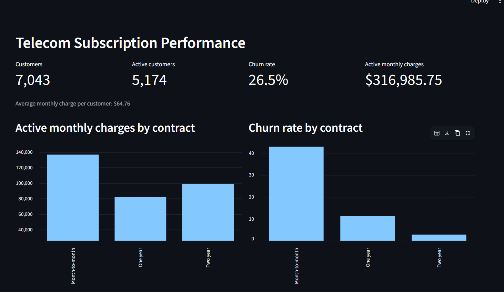

# 📊 Conversational AI Analytics Engine

**Live app:** [Open the Streamlit app](https://ai-analytics-agent-ecdgbeymdrmqyxszp4lulf.streamlit.app)

An analytics assistant that turns plain-English questions into DuckDB queries, displays results and charts, and generates summaries using a Groq-hosted language model.

## Features

- **Subscription dashboard:** customer count, active customer count, churn rate, and active monthly charges.
- **Natural-language analytics:** ask questions about the subscription data in plain English.
- **Query results:** view the generated SQL and result table.
- **Visualizations:** charts for active monthly charges and churn rate by contract type.
- **Executive summary:** generate a short interpretation of query results.

## Dashboard



## Dataset

This project uses IBM’s [Telco Customer Churn sample dataset](https://github.com/IBM/telco-customer-churn-on-icp4d/blob/master/data/Telco-Customer-Churn.csv). The source repository includes an [Apache License 2.0](https://github.com/IBM/telco-customer-churn-on-icp4d/blob/master/LICENSE).

The dataset contains 7,043 records for a fictional telecommunications company. The app’s `subscriptions.csv` maps IBM’s `Contract` field to `plan`, `MonthlyCharges` to `monthly_price`, `tenure` to `tenure_months`, and `Churn = Yes/No` to `status = cancelled/active`.

This is sample data, not current data from a real company. It has no signup dates, so the dashboard does not report monthly signup trends.

## Metric definitions

- **Customers:** number of customer records in the dataset.
- **Active customers:** records with `status = active`.
- **Churn rate:** cancelled customers divided by all customers in the group, multiplied by 100.
- **Active monthly charges:** sum of `monthly_price` for active customers. This is a sample-based estimate, not audited company revenue.
- **Average monthly charge:** average `monthly_price` across all customer records.

## Example business questions

- Which contract type has the highest churn rate?
- How do active monthly charges compare by contract type?
- How does churn vary across customers with different tenure?

## Technology

- **App:** Streamlit
- **LLM API:** Groq through LangChain
- **Database:** DuckDB
- **Data and charts:** Pandas and Plotly

## Run locally

Use Python 3.12 and run these commands from the project folder:

```powershell
py -3.12 -m venv .venv
.\.venv\Scripts\Activate.ps1
python -m pip install -r requirements.txt
```

Create a `.env` file beside `app.py` and add your Groq API key:

```text
GROQ_API_KEY=your_real_groq_api_key
```

Keep `.env` private. Do not commit your API key to GitHub.

Start the app:

```powershell
streamlit run app.py
```

## Limitations

This is a portfolio demonstration using a fictional sample dataset. The churn rate describes the labels in that dataset; it does not explain why customers left or predict future churn. The app sends questions to a hosted LLM API and executes generated SQL against the app’s DuckDB data, so use non-sensitive data.
